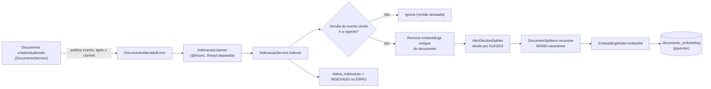

# RAG e embeddings

Este documento explica como um documento vira "pesquisável" pela IA (ingestão) e como uma
busca encontra os trechos certos (recuperação), incluindo controle de acesso e a regra de
"documentos vigentes".

## Pipeline de ingestão

Sempre que um documento é criado, atualizado, tem a categoria alterada ou tem o status de
ciclo de vida alterado, o sistema reindexa aquele documento — ou seja, recalcula os
embeddings dele e grava de novo no banco de vetores.

### Evento e listener assíncrono

- `document/service/DocumentoService.java` publica `DocumentoAlteradoEvent(documentoId,
  versao)` ao criar, atualizar, restaurar uma versão, ou mudar categoria/status de ciclo de
  vida de um documento (`document/event/DocumentoAlteradoEvent.java`); publica
  `DocumentoExcluidoEvent(documentoId)` ao excluir.
- `document/event/IndexacaoListener.java` escuta esse evento com
  `@TransactionalEventListener(phase = AFTER_COMMIT)` — ou seja, só reage depois que a
  transação HTTP original já commitou — e `@Async` numa thread separada, para nunca segurar
  a resposta da requisição esperando a indexação terminar.

### Divisão por seções e em chunks

`ai/ingestion/IndexacaoService.java` (método `indexar`, linha 49) faz, nesta ordem:

1. **Confere a versão** (linha 58): se a versão do documento já mudou desde que o evento foi
   publicado, a indexação é ignorada — uma execução atrasada nunca sobrescreve uma versão
   mais nova.
2. **Remove os embeddings antigos** do documento (`removerEmbeddingsDoDocumento`, linha 94),
   filtrando por `documento_id` no metadado.
3. **Divide em seções**: `ai/ingestion/HtmlSectionSplitter.java` usa a biblioteca Jsoup para
   percorrer o HTML e cortar em seções nos limites de `h1`, `h2` e `h3`, extraindo sempre
   texto limpo (nunca a tag HTML em si).
4. **Divide em chunks**: cada seção vira um `Document` do LangChain4j, prefixado com
   `"<TIPO> <título do documento> > <título da seção>\n<texto>"` (o prefixo de tipo é
   omitido quando o documento é `NAO_CLASSIFICADO`, linha 112-117) e então dividido por
   `DocumentSplitters.recursive(MAX_TOKENS_POR_CHUNK, SOBREPOSICAO_TOKENS)`
   (`IndexacaoService.java:40-41,103`), com **`MAX_TOKENS_POR_CHUNK = 600` e
   `SOBREPOSICAO_TOKENS = 80`**.

   **Atenção ao nome das constantes**: apesar de se chamarem "tokens", a chamada usada é a
   sobrecarga de dois argumentos de `DocumentSplitters.recursive`, que — confirmado
   inspecionando o bytecode de `langchain4j-1.18.0.jar`
   (`HierarchicalDocumentSplitter.estimateSize`) — passa `null` como estimador de tokens, e
   nesse caso o tamanho é medido em **caracteres** (`String.length()`), não em tokens de
   verdade. Ou seja: cada chunk tem até 600 caracteres, com até 80 caracteres de sobreposição
   entre chunks consecutivos — os nomes das constantes no código são, neste ponto,
   enganosos.
5. **Gera os embeddings** de todos os segmentos de uma vez (`embeddingModel.embedAll`, linha
   72).
6. **Grava no pgvector** (`embeddingStore.addAll`, linha 75), com um UUID aleatório por
   chunk.
7. Marca `status_indexacao` do documento como `INDEXADO` em caso de sucesso, ou `ERRO` se
   qualquer passo lançar exceção (linhas 78 e 84).

### Status de indexação

`document/entity/StatusIndexacao.java` define três valores: `PENDENTE`, `INDEXADO`, `ERRO`.
O campo correspondente é `DocumentoEntity.statusIndexacao`
(`document/entity/DocumentoEntity.java:49`, coluna `status_indexacao`).

### Metadados gravados em cada chunk

A tabela `documento_embedding` (criada/alterada por
`src/main/resources/db/migration/V14__add_metadados_rag_documento_embedding.sql`, e também
declarada no bean `embeddingStore` de `ai/embeddings/EmbeddingConfig.java:73-90`) tem estas
colunas de metadado por chunk, todas do tipo `COLUMN_PER_KEY` (uma coluna SQL por chave de
metadado, em vez de um blob JSON):

| Coluna | Sempre preenchida? | Observação |
|---|---|---|
| `documento_id` (uuid) | sim | indexada; usada para remover/filtrar os chunks de um documento |
| `versao` (integer) | sim | versão do documento no momento da indexação |
| `titulo` (text) | sim | título do documento |
| `secao` (text) | sim | âncora da seção (`HtmlSectionSplitter.Secao.ancora()`) |
| `status_ciclo_vida` (text) | **sim, sempre** | nunca omitida — ver "regra vigente por padrão" abaixo |
| `categoria_id` (bigint) | não | omitida quando o documento não tem categoria (achado em produção: `categoria_id` é legitimamente nulo para ao menos um documento) |
| `tipo_documento` (text) | não | omitida quando o tipo é `NAO_CLASSIFICADO` ou nulo |
| `macroprocesso_id` (bigint) | não | omitida quando nulo |
| `confidencialidade` (text) | não | omitida quando nula |

A razão de `status_ciclo_vida` ser a única coluna *sempre* preenchida (com o valor efetivo,
nunca omitida) é estrutural: o LangChain4j 1.18.0 não tem filtro `IS NULL` (ver
[`01-langchain4j.md`](01-langchain4j.md)), então um pré-filtro de busca só pode confiar numa
coluna que nunca é nula. Um documento sem status explícito grava `VIGENTE` (a "regra vigente
por padrão", ver mais abaixo) — nunca omite a chave (`IndexacaoService.java:128-149`).

Não há índice `ivfflat` na tabela (`useIndex(false)`,
`ai/embeddings/EmbeddingConfig.java:72`) — decisão deliberada: com poucas linhas
(documentação interna de uma empresa), um índice aproximado mal dimensionado fez a busca
por vizinho mais próximo devolver resultados incompletos de forma não-determinística
(confirmado na prática: com só 2 chunks e `lists=100`, o retriever não encontrou nada).
Varredura sequencial é exata e rápida o suficiente na escala atual.

## Status de indexação e reindexação

### Reindexação automática (documentos pendentes/com erro)

`document/job/ReindexacaoJob.java`, agendado via `@Scheduled(fixedDelayString =
"${app.reindexacao.intervalo-ms:300000}")` (padrão: a cada 5 minutos), busca documentos não
excluídos com `status_indexacao` em `PENDENTE` ou `ERRO`
(`findByDeletadoFalseAndStatusIndexacaoIn`) e chama `IndexacaoService.indexar` de novo para
cada um.

### Reindexação em massa (manual, ADMIN)

`ai/ingestion/ReindexacaoEmMassaService.java` reindexa **todos** os documentos não
excluídos, de forma assíncrona (`@Async("reindexacaoEmMassaExecutor")`), nunca automática —
existe principalmente para migrar chunks indexados antes de uma coluna de metadado nova ter
sido introduzida, sem precisar editar cada documento manualmente.

Exposta por `ai/ingestion/ReindexacaoEmMassaController.java`, sob `/admin/reindexacao`,
**só quando a feature flag `bdocs.documentacao-estruturada.enabled` está ligada** (ver
[`05-configuracao-e-custos.md`](05-configuracao-e-custos.md)):

- `POST /admin/reindexacao` (`hasRole('ADMIN')`) — dispara a reindexação de todos os
  documentos, devolve `202 Accepted` com a contagem.
- `GET /admin/reindexacao/status` (`hasRole('ADMIN')`) — devolve quantos chunks ainda não
  têm `status_ciclo_vida` (ver abaixo) e se o pré-filtro de ciclo de vida está ativo agora.

## Recuperação (busca semântica)

Existem **dois** caminhos de busca independentes, com constantes de ajuste diferentes:

| | `PesquisaService` | `RagAssistantConfig` (retriever automático) |
|---|---|---|
| Arquivo | `ai/retrieval/PesquisaService.java` | `ai/generation/RagAssistantConfig.java` |
| Quando roda | busca explícita (endpoint `GET /documentos/busca`, tools `buscarDocumentos`/`buscarDocumentosIncluindoHistorico`) | automaticamente, em **toda** mensagem do chat, antes do modelo responder |
| Resultados brutos buscados | `MAX_RESULTADOS_BRUTOS = 20` | `MAX_TRECHOS_BRUTOS = 15` |
| Score mínimo | `SCORE_MINIMO = 0.5` | `SCORE_MINIMO_RECUPERACAO = 0.75` |
| Resultado final | até `MAX_TRECHOS_POR_DOCUMENTO = 3` trechos por documento, documentos ordenados pelo melhor score | até `MAX_TRECHOS_RECUPERADOS = 5` trechos no total |

O score mínimo do retriever automático (0.75) é mais alto de propósito: com 0.6, um pedido
sobre emissão de nota fiscal recuperava trechos de política de férias e de senha — o modelo,
instruído a considerar esses trechos, travava pedindo esclarecimento em vez de seguir o
fluxo normal (comentário em `RagAssistantConfig.java:44-48`).

### Pré-filtro, proteção automática e pós-filtro

A regra de negócio é "por padrão, só mostrar documentos **vigentes**" (`StatusCicloVida` tem
os valores `EM_ELABORACAO`, `EM_REVISAO`, `VIGENTE`, `OBSOLETO` —
`document/entity/StatusCicloVida.java`). Essa regra é aplicada em **duas camadas**:

1. **Pré-filtro** (no pgvector, antes de rankear por score): um `Filter` de
   `status_ciclo_vida = VIGENTE`, calculado por
   `RagCicloVidaFiltroService.filtroStatusVigente()`
   (`ai/retrieval/RagCicloVidaFiltroService.java:59`). Esse método devolve um filtro vazio
   (ou seja, não filtra nada) em duas situações:
   - a feature flag `bdocs.rag.filtros-ciclo-vida.enabled` está desligada (padrão); ou
   - existe **qualquer** chunk em `documento_embedding` com `status_ciclo_vida IS NULL`
     (consulta SQL direta, linha 38) — ou seja, pelo menos um chunk nunca foi reindexado
     desde que esse metadado passou a existir.

   Essa segunda condição é a **proteção automática**: mesmo com a flag ligada, o pré-filtro
   só entra em ação quando todo chunk da base já tem o metadado novo — nunca excluindo um
   documento do RAG por falta de metadado. A contagem de chunks órfãos é cacheada (TTL
   configurável, `bdocs.rag.filtros-ciclo-vida.cache-ttl-minutos`) para não bater no banco a
   cada busca.

2. **Pós-filtro** (depois da busca, contra a tabela `documento`, nunca contra o metadado do
   chunk): `PesquisaService.documentoAcessivel` (linha 121) e
   `RagAssistantConfig.acessivelPelaCategoria`/`apenasVigente` (linhas 112–146). Conferir o
   status no banco (fonte da verdade) em vez de confiar no metadado do chunk garante que um
   chunk com metadado desatualizado nunca "ressuscite" um documento já marcado como
   obsoleto.

Com a flag `bdocs.rag.filtros-ciclo-vida.enabled` desligada (padrão), nenhuma das duas
camadas muda o comportamento de hoje, para nenhum papel — inclusive ADMIN.

### Controle de acesso por categoria

`categories/service/CategoriaAccessService.java` é o ponto único de controle de acesso por
categoria: ADMIN tem acesso irrestrito; EDITOR e USUARIO só acessam documentos das
categorias em que estão vinculados (tabela `usuario_categoria`); um usuário sem nenhuma
categoria vinculada não acessa documento nenhum. Esse serviço é chamado tanto no pós-filtro
de `PesquisaService` quanto no de `RagAssistantConfig` — **nunca** no metadado do chunk (o
chunk nem guarda a categoria de forma confiável para isso, já que `categoria_id` pode ser
nulo).

Importante: com a flag de ciclo de vida ligada, **ADMIN também passa a só ver documentos
vigentes por padrão** no chat — só o controle de acesso por categoria continua irrestrito
para ADMIN (decisão registrada em comentário, `RagAssistantConfig.java:76-81`, datada de
2026-10-10).

### "Documentos vigentes" e a busca "com histórico"

`DocumentoEntity.isVigente()` (`document/entity/DocumentoEntity.java:120`) trata um
documento sem status explícito (`statusCicloVida == null`) como vigente — a "regra vigente
por padrão": nunca excluir do RAG um documento legado só porque ele nunca recebeu essa
classificação.

Não existe reescrita de busca com base no **histórico da conversa** (nenhum
`QueryTransformer`). "Buscar incluindo histórico" aqui significa outra coisa: a tool
`buscarDocumentosIncluindoHistorico`
(`document/tool/DocumentoTools.java:116`, chamando `PesquisaService.buscar(consulta, true)`)
pula completamente o filtro de ciclo de vida (pré e pós-busca), mesmo com a flag ligada —
é o único caminho explícito até documentos `EM_ELABORACAO`/`EM_REVISAO`/`OBSOLETO`. A busca
padrão (`buscarDocumentos`, ou o parâmetro `incluirHistorico=false`) sempre aplica o filtro
de vigência quando a flag está ligada.

## Provedores de embedding: ONNX local × OpenAI

`ai/embeddings/EmbeddingConfig.java` escolhe o provedor via `app.ai.embedding-provider` (env
`AI_EMBEDDING_PROVIDER`):

- **`local`** (padrão): `AllMiniLmL6V2QuantizedEmbeddingModel`, um modelo ONNX quantizado
  rodando dentro do próprio processo Java — sem chave de API, sem chamada de rede. Dimensão
  do vetor: `384` (`app.ai.local-embedding-dimension`).
- **`openai`**: `OpenAiEmbeddingModel`, via API da OpenAI (`app.ai.openai-api-key` +
  `app.ai.embedding-model`, padrão `text-embedding-3-small`). Dimensão do vetor: `1536`
  (`app.ai.embedding-dimension`).

A dimensão do vetor é definida na criação da tabela pgvector (`.dimension(dimension)`,
`EmbeddingConfig.java:61`), de acordo com o provedor ativo no momento. **Trocar de provedor
exige reindexar tudo**: os vetores já gravados têm a dimensão do provedor anterior, e uma
coluna `vector(384)` não é compatível com embeddings de 1536 dimensões (ou vice-versa) —
cada provedor também gera vetores com geometria diferente, então mesmo que a dimensão
coincidisse, os vetores de um não seriam comparáveis aos do outro. *A confirmar*: não há uma
nota operacional explícita no código dizendo "rode a reindexação em massa depois de trocar o
provedor" — esta conclusão vem da análise da configuração da tabela, não de um comentário
dedicado a isso.
