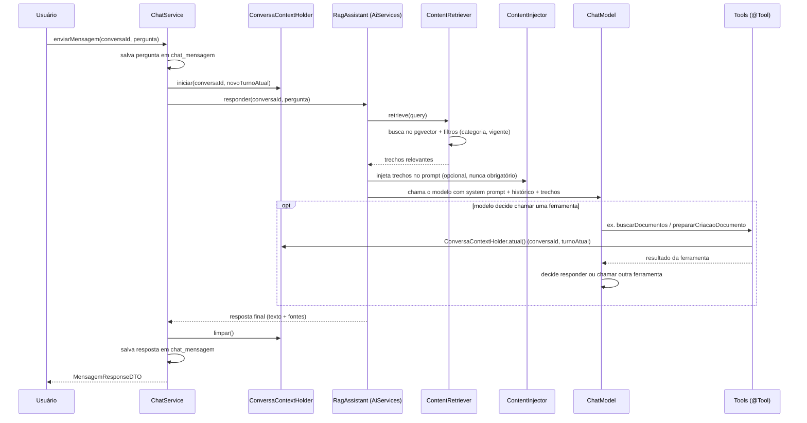

# Chat com IA e ferramentas (`@Tool`)

## Visão geral: um assistente, dois perfis de comportamento

Existe apenas **uma** interface `AiServices`: `RagAssistant`
(`ai/generation/RagAssistant.java:14`), com um único método:

```java
Result<String> responder(@MemoryId UUID conversaId, @UserMessage String pergunta)
```

A partir dela, `ai/generation/RagAssistantConfig.java` monta **dois beans diferentes**, com
comportamentos distintos (o Javadoc da interface `RagAssistant` está desatualizado — diz que
ela "não recebe tools", o que só vale para um dos dois beans):

| Bean | Linha | Quem usa | Tem ferramentas? |
|---|---|---|---|
| `ragAssistantSomenteLeitura` | `RagAssistantConfig.java:195` | papel **USUARIO** | não — só lê o contexto recuperado e responde |
| `ragAssistantComFerramentas` | `RagAssistantConfig.java:224` | papéis **EDITOR**/**ADMIN** | sim — pode propor criação/atualização de documentos e categorias |

A escolha de qual bean usar é feita em
`chat/service/ChatService.java:275-277`, dentro do método privado
`processarPerguntaEResponder`:

```java
RagAssistant assistente = currentUserProvider.isEditorOuAdmin()
        ? ragAssistantComFerramentas
        : ragAssistantSomenteLeitura;
```

Não existe um controller dedicado de IA (o pacote `ai/controller` está vazio) — o chat é
exposto por `chat/controller/ChatController.java`, que delega para `ChatService`.

## Sequência de uma pergunta no chat



## System prompts

Os textos de system prompt do chat interativo estão em
`ai/prompt/RagSystemPrompt.java`, sem nenhum rótulo de versão ("v1"/"v2") — a dualidade real
é **somente leitura** × **com ferramentas**:

- `RagSystemPrompt.TEXTO` (linhas 5-12) — usado pelo bean `ragAssistantSomenteLeitura`.
  Instrui o modelo a responder só com base nos trechos fornecidos, dizer claramente quando
  não encontrar a resposta, e deixa explícito que esse assistente não tem nenhuma ferramenta
  para alterar documentos.
- `RagSystemPrompt.TEXTO_COM_FERRAMENTAS` (linhas 14-95) — usado pelo bean
  `ragAssistantComFerramentas`. Contém toda a regra de fluxo: buscar documentos existentes
  antes de propor criação, listar categorias, redigir o conteúdo em HTML formal (não apenas
  reorganizar o texto do usuário), preparar a proposta, e **nunca confirmar no mesmo turno em
  que propôs** — só depois que o usuário confirmar em uma mensagem separada.

A escolha entre os dois textos acompanha a escolha do bean/papel do usuário
(`.systemMessageProvider(memoryId -> RagSystemPrompt.TEXTO...)`, linhas 204 e 246 de
`RagAssistantConfig.java`), não uma flag separada.

Existe um outro prompt rotulado **"V1"**, mas em um fluxo completamente diferente:
`document/service/GeracaoEstruturadaSystemPrompt.java:4` — usado só pelo worker de geração
assíncrona de documento estruturado (ver
[`04-documentacao-estruturada.md`](04-documentacao-estruturada.md)), "independente do
`RagSystemPrompt` usado pelo chat interativo" (conforme o próprio Javadoc da classe). Não há
uma constante "V2" correspondente hoje — o rótulo "V1" marca apenas uma iteração do texto
validada empiricamente, não um sistema de versionamento ativo.

## Memória de conversa

- `ChatMemoryProvider` — bean em `RagAssistantConfig.java:184` — usa
  `MessageWindowChatMemory` com janela de **20 mensagens** (`JANELA_MEMORIA_MENSAGENS = 20`,
  linha 50).
- Persistência real: `chat/service/PersistentChatMemoryStore.java`, implementando
  `ChatMemoryStore`. A fonte da verdade entre turnos é a tabela `chat_mensagem`
  (via `IMensagemRepository`).
- Detalhe não óbvio: **dentro de um mesmo turno**, o laço de chamada de ferramentas do
  `AiServices` lê a memória várias vezes — e cada chamada de ferramenta só fica persistida
  em `chat_mensagem` no final do turno inteiro (em `ChatService`). Por isso
  `PersistentChatMemoryStore` mantém um cache em memória por turno
  (`ConcurrentHashMap<UUID, List<ChatMessage>>`) que é priorizado sobre o banco enquanto o
  turno está em andamento — sem isso, o modelo "esqueceria" de ter acabado de chamar uma
  ferramenta e repetiria a mesma chamada indefinidamente. O cache é invalidado
  (`invalidar(conversaId)`) depois que `ChatService` persiste a mensagem final do turno
  (`ChatService.java:282`) e quando a conversa é excluída.

## `ContentInjector` customizado

Bean `contentInjector()` em `RagAssistantConfig.java:156`. O template padrão do LangChain4j
injeta os trechos recuperados como instrução obrigatória ("responda usando..."), o que
travava o modelo quando os trechos recuperados não tinham nada a ver com o pedido (ex.:
pedir para criar um documento sobre um assunto novo, sem nenhum trecho relevante na base).
O template customizado deixa explícito que os trechos são referência **opcional**, a
ignorar quando irrelevantes (texto completo nas linhas 158-169 do mesmo arquivo).

## Entrada por áudio e por anexo

Além de texto digitado, o chat aceita áudio e documentos anexados
(`chat/controller/ChatController`/`ChatService.enviarMensagemComArquivo`,
`ChatService.java:203`):
- **Áudio**: `chat/service/AudioTranscricaoService.java` transcreve usando o próprio
  `ChatModel` do chat (ele aceita áudio nativamente como entrada multimodal — sem um serviço
  de transcrição dedicado como o Whisper).
- **Anexo**: `chat/service/AnexoTextoExtractorService.java` extrai texto de `.txt`, `.md`,
  `.html`/`.htm` e PDF (via o mesmo modelo multimodal, sem biblioteca de parsing dedicada) —
  formatos binários como `.docx` ainda não são suportados.

O texto resultante (transcrição ou extração) entra na conversa como uma seção rotulada e
segue o mesmo pipeline de uma mensagem de texto comum, inclusive a conversão para Markdown
de textos grandes (`chat/service/MarkdownConversorService.java`, acima de
`app.chat.limite-caracteres-texto-grande` caracteres).

## Tabela completa de ferramentas (`@Tool`)

| Ferramenta | Classe / arquivo | O que faz | Perfis permitidos | Depende de flag? |
|---|---|---|---|---|
| `listarMinhasCategorias` | `document/tool/DocumentoTools.java:58` | Lista as categorias que o usuário atual pode acessar (ADMIN vê todas) | EDITOR/ADMIN¹ | não |
| `buscarDocumentos` | `document/tool/DocumentoTools.java:86` | Busca semântica de documentos vigentes (via `PesquisaService`) | EDITOR/ADMIN¹ | não |
| `buscarDocumentosIncluindoHistorico` | `document/tool/DocumentoTools.java:116` | Mesma busca, incluindo documentos não-vigentes (em elaboração/revisão/obsoletos) | EDITOR/ADMIN¹ | não (mas o próprio efeito de "vigente" depende de `bdocs.rag.filtros-ciclo-vida.enabled`) |
| `prepararCriacaoDocumento` | `document/tool/DocumentoTools.java:145` | Grava um **rascunho** de criação de documento (HTML) — nunca salva o documento final | EDITOR/ADMIN¹ | não |
| `prepararAtualizacaoDocumento` | `document/tool/DocumentoTools.java:212` | Idem, para atualização de um documento existente | EDITOR/ADMIN¹ | não |
| `confirmarRascunhoPendente` | `document/tool/DocumentoTools.java:279` | Efetiva o rascunho mais recente da conversa como documento real — só funciona num turno posterior ao da proposta | EDITOR/ADMIN¹ | não |
| `descartarRascunhoPendente` | `document/tool/DocumentoTools.java:347` | Descarta o rascunho pendente (ou em geração) sem salvar nada | EDITOR/ADMIN¹ | não |
| `prepararCriacaoCategoria` | `categories/tool/CategoriaTools.java:48` | Grava rascunho de categoria nova | EDITOR pode propor¹ | não |
| `confirmarCriacaoCategoria` | `categories/tool/CategoriaTools.java:89` | Efetiva a categoria — recusa com mensagem clara se quem confirma não é ADMIN | **ADMIN apenas** (checado dentro de `CategoryService.save`) | não |
| `descartarCriacaoCategoria` | `categories/tool/CategoriaTools.java:130` | Descarta a proposta de categoria pendente | EDITOR/ADMIN¹ | não |
| `listarMacroprocessos` | `document/tool/MacroprocessoTools.java:32` | Lista macroprocessos existentes (só leitura) | EDITOR/ADMIN¹ | **sim** — bean só existe com `bdocs.documentacao-estruturada.enabled=true` |
| `solicitarGeracaoDocumentoEstruturado` | `document/tool/DocumentoEstruturadoTools.java:56` | Dispara a geração **assíncrona** de um documento estruturado (cria rascunho em `GERANDO` e publica um evento) | EDITOR/ADMIN¹ | **sim**, em dobro — bean exige a flag ligada **e** só é adicionado às tools do assistente quando o provedor de chat ativo também está habilitado para o caminho estruturado (`FeatureFlags.documentacaoEstruturadaHabilitadaPara`) |
| `solicitarAtualizacaoDocumentoEstruturado` | `document/tool/DocumentoEstruturadoTools.java:78` | Idem, para atualização estruturada de um documento existente | EDITOR/ADMIN¹ | mesma dupla condição acima |

¹ "EDITOR/ADMIN" aqui significa: a ferramenta só existe para esses papéis porque é só o bean
`ragAssistantComFerramentas` que a inclui — não há uma anotação `@PreAuthorize` na própria
tool para isso. O controle de acesso que *existe* dentro das tools é por **categoria**
(`CategoriaAccessService.validarAcessoCategoria`, lança `AccessDeniedException`, convertida
em mensagem de texto explicativa para o modelo) e, no caso de categoria, a regra
admin-only dentro de `CategoryService.save`.

## A regra "propor → confirmar em turno separado"

Mecanismo: `chat/service/ConversaContextHolder.java` — um `ThreadLocal` guardando um
`record Contexto(UUID conversaId, UUID turnoAtual)`. A cada chamada de
`ChatService.enviarMensagem`/`enviarMensagemComArquivo` (que delegam para o método privado
`processarPerguntaEResponder`), um novo `UUID turnoAtual = UUID.randomUUID()` é gerado
(`ChatService.java:270`) e disponibilizado via `ConversaContextHolder.iniciar(conversaId,
turnoAtual)` (linha 271), limpo no `finally` (linha 281).

Ao preparar um rascunho, o campo `turnoCriacao` da entidade (`RascunhoDocumentoEntity`,
`CategoriaRascunhoEntity`) é gravado com o `turnoAtual` **só se o rascunho é novo** — se já
existe um rascunho ativo desta conversa, seu `turnoCriacao` original é preservado, mesmo que
o conteúdo seja atualizado (o modelo às vezes "reprepara" a mesma proposta antes de
confirmar — se isso resetasse o turno, a confirmação nunca seria possível no mesmo turno em
que foi "reproposta", mesmo tendo passado por um turno de verdade anterior).

Ao confirmar (`confirmarRascunhoPendente`, `DocumentoTools.java:301`, e
`confirmarCriacaoCategoria`, `CategoriaTools.java:102`), a checagem é:

```java
if (rascunho.getTurnoCriacao().equals(contexto.turnoAtual())) {
    return "Ainda não é possível confirmar: ...";
}
```

Essa trava é **imposta em código**, não apenas por instrução de prompt — mesmo que o modelo
tentasse chamar a confirmação na mesma resposta em que propôs, a ferramenta recusaria porque
`turnoCriacao == turnoAtual` nesse caso. O system prompt
(`RagSystemPrompt.TEXTO_COM_FERRAMENTAS`) reforça essa regra com instrução explícita, mas a
garantia de fato está no código, não no texto do prompt.
