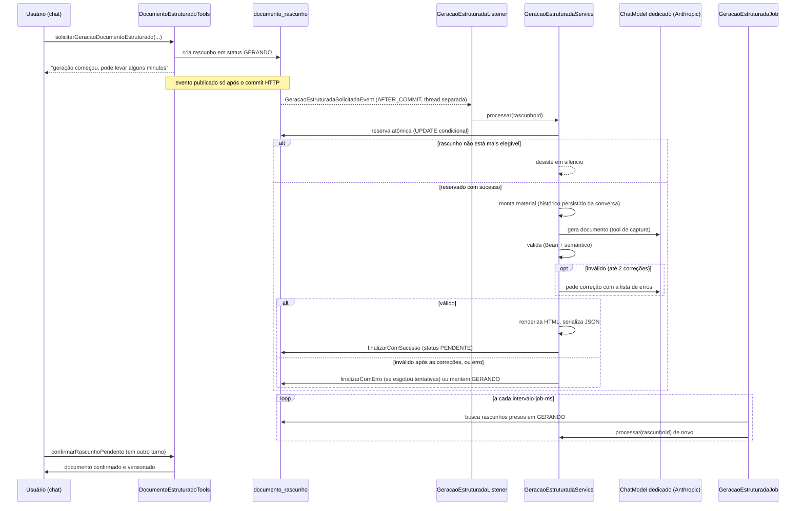

# Documentação estruturada

Esta é a funcionalidade mais recente da camada de IA: em vez de a IA escrever HTML livre
(fluxo descrito em [`03-chat-e-tools.md`](03-chat-e-tools.md), ferramentas
`prepararCriacaoDocumento`/`prepararAtualizacaoDocumento`), o usuário pode pedir um
documento de **processo** ou **procedimento** seguindo um formato estruturado e padronizado
(SIPOC, RACI, fluxo por etapas), gerado em segundo plano.

Toda esta funcionalidade só existe com a feature flag `bdocs.documentacao-estruturada.enabled`
ligada — com ela desligada, nada neste documento existe em tempo de execução (ver
[`05-configuracao-e-custos.md`](05-configuracao-e-custos.md)).

## Tipos de documento e status de ciclo de vida

`document/entity/TipoDocumento.java` define seis valores: `POLITICA`, `PROCESSO`,
`PROCEDIMENTO`, `INSTRUCAO`, `REGISTRO`, `NAO_CLASSIFICADO` (este último é o valor dos
documentos criados antes dessa coluna existir). **Só `PROCESSO` e `PROCEDIMENTO` são
aceitos pela geração estruturada** nesta entrega
(`document/service/DocumentoEstruturadoValidator.java:50-57`) — os demais tipos continuam
só pelo fluxo HTML legado.

Há **três enums de status diferentes**, fáceis de confundir:

| Enum | Arquivo | Valores | Representa |
|---|---|---|---|
| `StatusCicloVida` | `document/entity/StatusCicloVida.java` | `EM_ELABORACAO`, `EM_REVISAO`, `VIGENTE`, `OBSOLETO` | o ciclo de vida do **conteúdo** do documento (usado pelo RAG, ver [`02-rag-embeddings.md`](02-rag-embeddings.md)) |
| `StatusIndexacao` | `document/entity/StatusIndexacao.java` | `PENDENTE`, `INDEXADO`, `ERRO` | status da indexação no RAG |
| `StatusRascunho` | `document/entity/StatusRascunho.java` | `PENDENTE`, `CONFIRMADO`, `DESCARTADO`, `GERANDO`, `ERRO_GERACAO` | status de uma **proposta** da IA ainda não confirmada |

Não existe ainda um fluxo de aprovação entre os estados de `StatusCicloVida` (comentário
explícito em `StatusCicloVida.java:8-12`: fica para uma entrega futura) — hoje, todo
documento criado/atualizado vai direto para `VIGENTE`. A única forma de mudar o status é o
endpoint `PATCH /documentos/{id}/status-ciclo-vida`
(`document/controller/DocumentoStatusCicloVidaController.java`, `hasRole('ADMIN')`, também
atrás da mesma feature flag), que chama `DocumentoService.atualizarStatusCicloVida` — uma
troca direta, sem validação de transição, que não versiona o conteúdo mas dispara
reindexação (para sincronizar o metadado `status_ciclo_vida` nos chunks).

`StatusRascunho.ativos()` (`StatusRascunho.java:17`) define quais estados contam como
"proposta ativa" de uma conversa: `PENDENTE`, `GERANDO`, `ERRO_GERACAO` — nunca
`CONFIRMADO`/`DESCARTADO`.

## Metadados (colunas) × conteúdo estruturado (JSONB)

`document/entity/DocumentoEntity.java` (tabela `documento`) separa estritamente dois tipos
de informação, por decisão de design explícita no código ("decisão B3"):

- **Metadados**, em colunas próprias: `tipo_documento`, `status_ciclo_vida`, `dono_processo`,
  `aprovador`, `data_vigencia`, `proxima_revisao`, `periodicidade_revisao` (meses),
  `confidencialidade`, `tags` (`text[]`), `macroprocesso_id`, `processo_pai_id`.
- **Conteúdo estruturado**: coluna `conteudo_estruturado` (jsonb, via
  `@JdbcTypeCode(SqlTypes.JSON)`) + `versao_schema` (varchar) — guarda **só** o conteúdo
  (objetivo, escopo, fluxo, regras...), nunca metadado. Fica `NULL` quando o documento foi
  criado/atualizado só pelo fluxo legado de HTML.

A mesma separação se repete em `DocumentoVersaoEntity` (tabela `documento_versao`, cada
versão com seu próprio snapshot de `conteudo_estruturado` + `versao_schema`). Já em
`RascunhoDocumentoEntity` (tabela `documento_rascunho`), o campo `conteudo_estruturado`
guarda **conteúdo e metadado juntos** — por ser só uma proposta ainda não confirmada; a
separação entre as duas coisas só acontece no momento da confirmação
(`document/service/DocumentoEstruturadoAplicadorService.java`, ver abaixo).

## O DTO estruturado e o validador semântico

`document/dto/estruturado/DocumentoEstruturadoDTO.java` é um `record` com campos de
conteúdo (`titulo`, `tipoDocumento`, `objetivo`, `escopo`, `gatilho`, `raci`, `fluxo`,
`sipoc` opcional, `regrasNegocio`, `excecoes`, `sistemasFerramentas`, `riscosControles`,
`indicadores`, `glossario`, `documentosRelacionados`, `pendencias`) seguido de um bloco de
metadados (`macroprocessoId`, `processoPaiId`, `areasParticipantes`, `donoProcesso`,
`aprovador`, `periodicidadeRevisaoMeses`, `confidencialidade`, `tags`) que **nunca** entra no
JSON de conteúdo salvo. Cada campo tem uma anotação `@Description` do LangChain4j, que é o
que vira o schema de *structured output* exigido do modelo. A constante
`VERSAO_SCHEMA_ATUAL = "1.0"` (linha 131) é gravada em `versao_schema`, para permitir evoluir
o formato no futuro sem quebrar documentos já salvos.

`document/service/DocumentoEstruturadoValidator.java` faz a validação **semântica** (além da
Bean Validation do próprio record) — nunca lança exceção, devolve uma `List<String>` de
erros (vazia = válido):

- só `PROCESSO`/`PROCEDIMENTO` são aceitos como `tipoDocumento`;
- IDs duplicados entre etapas, regras de negócio ou exceções;
- referências de `regrasAplicaveis` de uma etapa devem existir em `regrasNegocio`;
- uma etapa não pode ter `proximaEtapaId` **e** `decisao` ao mesmo tempo;
- `proximaEtapaId` e as opções de uma decisão devem apontar para etapas que existem;
- toda decisão precisa de pelo menos 2 opções;
- toda linha da matriz RACI deve referenciar uma etapa existente;
- nenhuma etapa pode ser "órfã" — toda etapa (exceto a primeira) precisa ser alcançável a
  partir da primeira, seguindo `proximaEtapaId`/`decisao.opcoes` (busca em largura,
  `validarEtapaOrfa`).

## Renderizador HTML

`document/service/EstruturaDocumentoHtmlRenderer.java` converte o DTO em HTML de forma
**determinística** (mesma entrada sempre produz a mesma saída — nada de IA nesse passo).
Duas regras de segurança/design importantes:

1. Todo texto vindo do LLM é inserido como texto escapado (`Entities.escape`, do Jsoup) antes
   de virar HTML — um "objetivo" contendo `<script>` nunca vira uma tag, fica visível como
   texto literal. O HTML final ainda passa pelo `HtmlSanitizerService` padrão, como qualquer
   outro conteúdo.
2. Cada etapa/regra/exceção vira um `<h3>` com o ID embutido no próprio texto (ex.:
   `"RN-01 — ..."`) — de propósito, para que o `HtmlSectionSplitter` da indexação (que já
   corta por `h1`/`h2`/`h3`, ver [`02-rag-embeddings.md`](02-rag-embeddings.md)) gere um
   chunk por item atômico, sem precisar de nenhuma mudança no splitter.

## Fluxo de geração assíncrona

### Tool leve

`document/tool/DocumentoEstruturadoTools.java` — `solicitarGeracaoDocumentoEstruturado`
(criação, linha 56) e `solicitarAtualizacaoDocumentoEstruturado` (atualização, linha 78).
**Nunca** recebe o documento completo como argumento: só cria (ou reaproveita) um
`RascunhoDocumentoEntity` em `GERANDO`, zera os campos de conteúdo, e publica
`GeracaoEstruturadaSolicitadaEvent` (método privado `solicitar`, linha 100). Um rascunho que
tinha terminado em `ERRO_GERACAO` nunca é reaproveitado em memória — é descartado e um
rascunho novo é criado do zero para a nova tentativa, preservando o histórico do erro
anterior como uma linha `DESCARTADO` própria.

### Listener e worker

- `document/event/GeracaoEstruturadaListener.java` — `@TransactionalEventListener(phase =
  AFTER_COMMIT)` + `@Async("geracaoEstruturadaExecutor")`: reage só depois do commit da
  transação HTTP, em thread separada (a geração pode levar mais de 2 minutos).
- `document/service/GeracaoEstruturadaService.java`, método `processar(UUID rascunhoId)`
  (linha 137):
  1. **Reserva atômica** (`reservarParaProcessamento`, um UPDATE condicional que só afeta a
     linha se ela ainda estiver elegível) — garante que o mesmo rascunho nunca é processado
     duas vezes ao mesmo tempo (pelo listener e pelo job, por exemplo). Zero linhas afetadas
     = "outro worker já pegou" ou "o usuário descartou" — desiste em silêncio.
  2. **Monta o material-fonte** (`montarMaterial`) a partir do histórico **persistido** da
     conversa até o momento da solicitação (nunca mensagens de turnos posteriores) +
     instruções adicionais da tool. Se o material exceder
     `material-max-caracteres` (padrão 60000), finaliza direto com erro.
  3. **Gera e valida** (`gerarDocumentoValidado`): monta um `AiServices` interno (interface
     local `Assistente`, com os métodos `gerar`/`corrigir`), com uma `ChatMemory` de janela
     20 e uma única tool de captura (`FerramentaCaptura.registrarDocumentoEstruturado`, que
     apenas guarda o DTO recebido). Se a validação (Bean + `DocumentoEstruturadoValidator`)
     encontrar erros, o worker pede correção ao modelo (reenviando a lista de erros) até
     **2 correções por tentativa** (`MAX_CORRECOES_POR_TENTATIVA = 2`) — dentro da mesma
     "conversa"/tentativa, sem custo de uma tentativa completa nova.
  4. **Sucesso**: renderiza o HTML, serializa o JSON, grava via `finalizarComSucesso` (UPDATE
     condicional — só grava se o rascunho ainda estiver `GERANDO`; se o usuário já descartou
     nesse meio-tempo, o resultado é silenciosamente descartado).
  5. **Falha**: se já atingiu `max-tentativas` (padrão 2), finaliza com erro
     (`ERRO_GERACAO`); senão, permanece em `GERANDO` para o job de segurança tentar de novo.

### Reserva/concorrência e job de recuperação

O campo `reservadoEm` em `RascunhoDocumentoEntity` marca quando um worker reservou aquele
rascunho. `document/job/GeracaoEstruturadaJob.java`, agendado via
`@Scheduled(fixedDelayString = "${...intervalo-job-ms}")` (padrão 60s), busca todos os
rascunhos em `GERANDO` e chama `processar` de novo para cada um — a reserva atômica garante
que isso nunca reprocessa um que já esteja sendo processado; cobre apenas o caso de evento
perdido ou processo reiniciado no meio de uma geração (timeout configurável via
`timeout-gerando-minutos`, padrão 5 minutos).

### Modo modelo-fake

Flag `bdocs.documentacao-estruturada.geracao.modelo-fake` (padrão `false`). Quando `true`, o
worker **nunca** chama o `ChatModel` real — devolve um documento de exemplo fixo e válido
("Política de Reembolso de Despesas de Viagem") depois de um atraso configurável (padrão
5000ms, só para a UI mostrar o estado `GERANDO`). Existe para testar manualmente a
reserva/concorrência/polling/UI de ponta a ponta sem gastar créditos de API — **nunca deve
ser `true` em produção**.

## Confirmação, versionamento, restauração

A confirmação é feita pela mesma tool do fluxo legado,
`confirmarRascunhoPendente` (`document/tool/DocumentoTools.java:279`, ver
[`03-chat-e-tools.md`](03-chat-e-tools.md) para a regra de turno separado). Dentro dela, o
caminho de aplicação é decidido por `rascunho.getConteudoEstruturado() != null`:

- **Com conteúdo estruturado**: `DocumentoEstruturadoAplicadorService.aplicar(rascunho)` —
  desserializa o JSON completo do rascunho, separa em conteúdo (`serializarSoConteudo`, só
  os campos de conteúdo) e metadados (`DocumentoEstruturadoMetadadosDTO`), e chama
  `DocumentoService.criarComEstrutura`/`atualizarComEstrutura`.
- **Sem conteúdo estruturado** (fluxo legado): `DocumentoService.criar`/`atualizar`, como
  descrito em [`03-chat-e-tools.md`](03-chat-e-tools.md).

`DocumentoService.aplicarNovaVersao` (linha 476) é o método central, compartilhado por
`atualizar`, `atualizarComEstrutura` e `restaurarVersao`: incrementa `versaoAtual`, grava uma
linha nova em `DocumentoVersaoEntity` (snapshot completo, incluindo `conteudo_estruturado` e
`versao_schema`), recalcula `proximaRevisao`, e publica `DocumentoAlteradoEvent` (disparando
reindexação).

**Restauração** (`DocumentoService.restaurarVersao`, linha 329, `hasRole('ADMIN')`): busca a
versão alvo, sanitiza o HTML dela de novo, e chama `aplicarNovaVersao` trazendo de volta
também o `conteudoEstruturado`/`versaoSchema` **daquela versão** — ou seja, restaurar é só
mais uma "nova versão", cujo conteúdo é cópia de uma versão antiga.

**Zerar o JSON no update legado** (confirmado em `DocumentoService.atualizar`, linhas
98-134): quando o conteúdo muda de verdade (hash diferente) pelo fluxo **legado** de HTML, o
método chama `aplicarNovaVersao(..., conteudoEstruturado=null, versaoSchema=null)`
explicitamente — ou seja, atualizar um documento estruturado pelo editor de HTML comum
invalida o conteúdo estruturado que ele tivesse. O JSON antigo continua preservado só na
versão anterior (histórico), nunca é copiado adiante por engano; isso é consistente com
`DocumentoRequestDTO` nunca carregar um campo estruturado.

## Governança: próxima revisão e revisão vencida

Campos em `DocumentoEntity`: `proximaRevisao` (`LocalDate`) e `periodicidadeRevisaoMeses`
(`Integer`, em meses — ex. 12 = revisão anual).

`DocumentoService.calcularProximaRevisao` (linha 263): se `periodicidadeRevisaoMeses` é
nulo, devolve `null`; senão, soma `periodicidadeRevisaoMeses` meses a `dataVigencia` (se
preenchida) ou, na prática hoje, a `LocalDate.now()` (já que `dataVigencia` nunca é definida
pelo DTO estruturado nesta entrega). É recalculado **toda vez** que os metadados são
aplicados ou que uma nova versão é gravada (`aplicarNovaVersao`) — nunca incrementalmente,
para que uma periodicidade alterada já reflita na próxima vez que o documento for salvo.

**Revisão vencida**: `DocumentoService.listar(categoriaId, somenteRevisaoVencida=true)`
filtra documentos cuja `proximaRevisao` já passou (`isBefore(LocalDate.now())`) — exceto
documentos `OBSOLETO` (`isRevisaoVencida`, linha 254: um processo que não está mais em vigor
não "deve" revisão). A indicação visual disso no frontend é responsabilidade do frontend —
*a confirmar* se já foi implementada.

## Macroprocessos e hierarquia

`document/entity/MacroprocessoEntity.java` (tabela `macroprocesso`) é uma classificação
complementar às categorias — um processo pode atravessar vários setores, então a
**categoria** (área dona) continua sendo o único controle de acesso; macroprocesso é só
organização/classificação (ex.: no estilo de um framework como o APQC).

Hierarquia processo-pai: colunas `macroprocesso_id` e `processo_pai_id` em `DocumentoEntity`,
alimentadas pelos campos `macroprocessoId`/`processoPaiId` do DTO estruturado, aplicadas em
`DocumentoService.aplicarMetadadosEstruturados` (linha 218) na confirmação. Um comentário
mais antigo em `DocumentoEntity.java:106-108` e em `DocumentoService.java:446` diz que
"nenhum caminho ainda seta esses campos" — isso está **desatualizado**: o código de
`aplicarMetadadosEstruturados` (chamado por `criarComEstrutura`/`atualizarComEstrutura`, via
`DocumentoEstruturadoAplicadorService`) efetivamente grava os dois campos quando o DTO os
traz preenchidos.

`DocumentoService.validarHierarquiaProcesso` (linha 448) impede ciclos: percorre a cadeia de
pais (até uma profundidade máxima de 50) e rejeita auto-referência ou qualquer ciclo
(A→B→A).

Vínculo N:N documento↔categoria "participante" (não dona):
`document/entity/DocumentoAreaParticipanteEntity.java` (tabela
`documento_area_participante`) — **apenas informativo**, nunca concede acesso; o único
controle de acesso continua sendo a categoria dona, via `CategoriaAccessService`. Essa
entidade não é referenciada em nenhum ponto de controle de acesso, de propósito.
