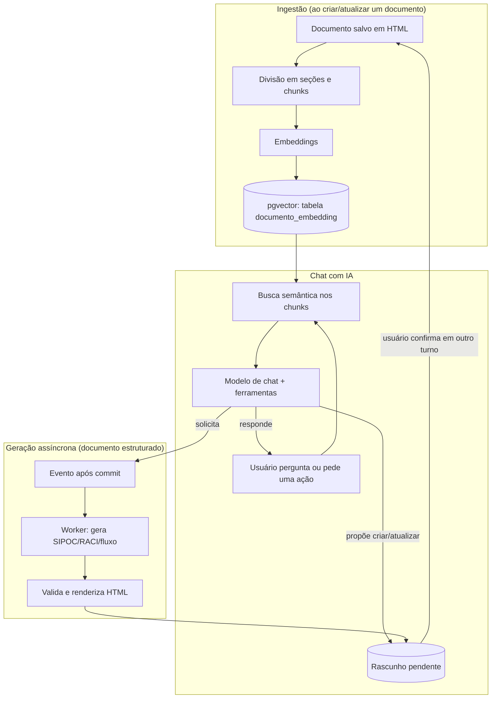

# Arquitetura de IA do Business Docs AI

Esta pasta documenta a camada de Inteligência Artificial do backend: como os documentos
são indexados para busca semântica, como o chat com IA responde perguntas e cria
documentos, e como funciona a geração assíncrona de documentação estruturada.

Público-alvo: desenvolvedores do time que já conhecem Java/Spring, mas não conhecem
LangChain4j nem os conceitos de RAG (Retrieval-Augmented Generation). Cada conceito é
explicado na primeira vez que aparece.

Tudo aqui foi escrito a partir do código da branch `main` neste momento. Onde o
comportamento não estava claro no código, o texto diz "a confirmar" em vez de supor.

**Convenção de caminhos**: para reduzir repetição, os caminhos de classes Java citados nesta
documentação omitem o prefixo comum `src/main/java/br/com/example/senac/businessDocsAi/`.
Por exemplo, `ai/ingestion/IndexacaoService.java` corresponde, na raiz do repositório, a
`src/main/java/br/com/example/senac/businessDocsAi/ai/ingestion/IndexacaoService.java`.
Caminhos de recursos (`application.yaml`, migrations SQL) são sempre citados por completo,
a partir da raiz do repositório.

## Índice

1. [`01-langchain4j.md`](01-langchain4j.md) — os conceitos do LangChain4j usados no projeto
   (ChatModel, AiServices, `@Tool`, ChatMemory, EmbeddingModel, EmbeddingStore, RAG) e onde
   cada um aparece no código.
2. [`02-rag-embeddings.md`](02-rag-embeddings.md) — o pipeline de ingestão (como um
   documento vira embeddings no banco), a recuperação (como uma pergunta busca os trechos
   certos), controle de acesso por categoria e a regra de "documentos vigentes".
3. [`03-chat-e-tools.md`](03-chat-e-tools.md) — os assistentes de chat, os system prompts,
   a memória de conversa, e a tabela completa de ferramentas (`@Tool`) que a IA pode chamar.
4. [`04-documentacao-estruturada.md`](04-documentacao-estruturada.md) — o fluxo de gerar um
   documento de processo/procedimento estruturado (SIPOC, RACI, fluxo por etapas) de forma
   assíncrona, com validação, versionamento e governança (revisão periódica).
5. [`05-configuracao-e-custos.md`](05-configuracao-e-custos.md) — todas as propriedades de
   configuração da IA, as duas feature flags, e como não gastar créditos de API à toa em
   desenvolvimento.
6. [`06-guia-pratico.md`](06-guia-pratico.md) — passo a passo para tarefas comuns (criar uma
   tool, trocar um prompt, reindexar, investigar um documento que não aparece no RAG) e um
   glossário dos termos usados nesta documentação.

## O que a IA faz no sistema, em uma frase

O sistema guarda documentação interna da empresa; a IA lê essa documentação (via busca
semântica/RAG) para responder perguntas no chat e, quando autorizada, também cria ou
atualiza documentos — seja escrevendo HTML diretamente (fluxo mais simples) ou gerando um
documento estruturado de processo em segundo plano (fluxo mais elaborado, com SIPOC/RACI).

## Diagrama geral

## Mapa de pacotes e arquivos

### `ai/embeddings`
| Arquivo | O que faz |
|---|---|
| `ai/embeddings/EmbeddingConfig.java` | Escolhe o provedor de embedding (ONNX local ou OpenAI) e configura o `PgVectorEmbeddingStore` (tabela `documento_embedding`). |

### `ai/generation`
| Arquivo | O que faz |
|---|---|
| `ai/generation/ChatModelConfig.java` | Escolhe o provedor do modelo de chat (Gemini/Anthropic/OpenAI) e configura o `ChatModel` dedicado ao worker de geração estruturada. |
| `ai/generation/RagAssistant.java` | Interface `AiServices` do assistente de chat com RAG. |
| `ai/generation/RagAssistantConfig.java` | Monta os dois beans do assistente (somente leitura / com ferramentas), o retriever com filtros, o `ContentInjector` e a memória de conversa. |

### `ai/ingestion`
| Arquivo | O que faz |
|---|---|
| `ai/ingestion/HtmlSectionSplitter.java` | Divide o HTML do documento em seções, respeitando os limites de `h1`–`h3`. |
| `ai/ingestion/IndexacaoService.java` | Pipeline completo: seções → chunks → embeddings → gravação no pgvector. |
| `ai/ingestion/ReindexacaoEmMassaService.java` | Reindexação manual de todos os documentos (ADMIN, assíncrona). |
| `ai/ingestion/ReindexacaoEmMassaController.java` | Endpoints `POST /admin/reindexacao` e `GET /admin/reindexacao/status`. |

### `ai/prompt`
| Arquivo | O que faz |
|---|---|
| `ai/prompt/RagSystemPrompt.java` | Os dois textos de system prompt do chat interativo (somente leitura e com ferramentas). |

### `ai/retrieval`
| Arquivo | O que faz |
|---|---|
| `ai/retrieval/PesquisaService.java` | Busca semântica explícita — usada pelo endpoint `GET /documentos/busca` e pelas tools `buscarDocumentos`/`buscarDocumentosIncluindoHistorico`. |
| `ai/retrieval/RagCicloVidaFiltroService.java` | Decide, a cada busca, se é seguro filtrar só documentos vigentes (proteção automática contra chunks sem metadado). |

### `document/tool` e `categories/tool`
| Arquivo | O que faz |
|---|---|
| `document/tool/DocumentoTools.java` | Ferramentas de IA para buscar, propor criação/atualização (HTML) e confirmar/descartar documentos. |
| `document/tool/DocumentoEstruturadoTools.java` | Ferramentas leves que só disparam a geração assíncrona de documento estruturado. |
| `document/tool/MacroprocessoTools.java` | Ferramenta de leitura de macroprocessos (só existe com a feature flag ligada). |
| `categories/tool/CategoriaTools.java` | Ferramentas de IA para propor e confirmar uma categoria nova. |

### Geração de documento estruturado (`document/service`, `document/job`, `document/event`)
| Arquivo | O que faz |
|---|---|
| `document/service/GeracaoEstruturadaService.java` | Worker que chama a IA, valida e corrige o documento estruturado gerado. |
| `document/service/GeracaoEstruturadaSystemPrompt.java` | Prompt usado pelo worker (independente do `RagSystemPrompt` do chat). |
| `document/service/DocumentoEstruturadoValidator.java` | Validação semântica do DTO estruturado (IDs únicos, referências válidas, sem etapa órfã). |
| `document/service/EstruturaDocumentoHtmlRenderer.java` | Renderiza o DTO estruturado em HTML determinístico. |
| `document/service/DocumentoEstruturadoAplicadorService.java` | Aplica a confirmação separando conteúdo (JSON) de metadado (colunas). |
| `document/service/DocumentoService.java` | CRUD, versionamento, restauração e governança (revisão periódica) de documentos. |
| `document/event/GeracaoEstruturadaListener.java` | Reage à solicitação de geração, após o commit, em thread separada. |
| `document/job/GeracaoEstruturadaJob.java` | Rede de segurança: reprocessa rascunhos presos em geração. |
| `document/event/IndexacaoListener.java` | Reage a alterações de documento disparando a indexação. |
| `document/job/ReindexacaoJob.java` | Reprocessa periodicamente documentos com indexação pendente/erro. |

### Configuração e chat
| Arquivo | O que faz |
|---|---|
| `config/FeatureFlags.java` | As duas feature flags da IA (documentação estruturada e filtros de ciclo de vida do RAG). |
| `chat/service/ChatService.java` | Orquestra uma mensagem de chat: persiste, escolhe o assistente certo, chama a IA, persiste a resposta. |
| `chat/service/ConversaContextHolder.java` | Marca em qual conversa/turno as ferramentas estão operando (base da regra "confirmar em turno separado"). |
| `chat/service/PersistentChatMemoryStore.java` | Faz a ponte entre a memória de conversa do LangChain4j e a tabela `chat_mensagem`. |
| `chat/service/AudioTranscricaoService.java` | Transcreve áudio enviado no chat usando o próprio `ChatModel` multimodal. |
| `chat/service/AnexoTextoExtractorService.java` | Extrai texto de um arquivo anexado no chat (txt/md/html/pdf). |

## Histórico de decisões

Duas entregas anteriores já documentaram, passo a passo, as decisões de design da
documentação estruturada e do RAG com ciclo de vida — mantidas como histórico:

- [`../plano-documentacao-estruturada.md`](../plano-documentacao-estruturada.md)
- [`../pr-documentacao-estruturada.md`](../pr-documentacao-estruturada.md)
